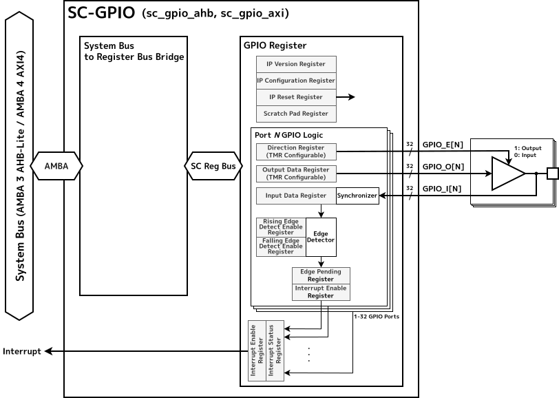

[[sc-gpio-overview]]
== Overview

SC-GPIO is an IP core that implements GPIO (General Purpose Input/Output) functionality.

Through register access, software can configure I/O signal directions and output signal levels and read input signal levels.
SC-GPIO can also detect rising and falling edges on input signals and notify the system through an interrupt.

The number of GPIO ports, the number of bits per port,
and signal direction settings can be configured at RTL design time to match the system.

For use in space environments that require high reliability,
SC-GPIO allows output signals to be configured with Triple Modular Redundancy (TMR) on a per-port basis.
This capability makes SC-GPIO suitable for systems with high reliability requirements.

=== Features

* Selectable AMBA 3 AHB-Lite or AMBA 4 AXI4 system bus
* Configurable number of GPIO ports from 1 to 32 and number of bits per port to match the system
* Per-bit selection of fixed or software-controlled I/O direction
* Configurable initial direction and output values for each GPIO bit
* Rising- and falling-edge detection on GPIO inputs with interrupt notification
* Per-port selection of TMR configuration for output signals

[[sc-gpio-block-diagram]]
== Block Diagram

