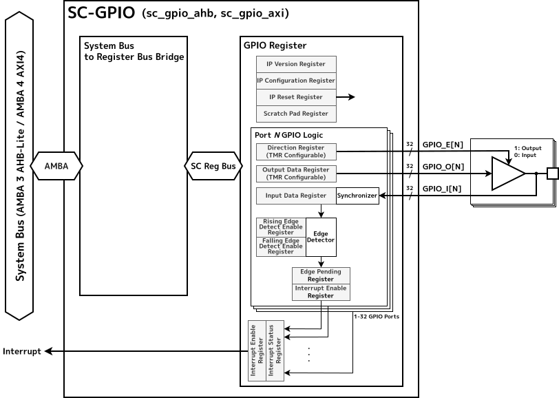

[[sc-gpio-overview]]
== Overview

SC-GPIOは、GPIO (General Purpose Input/Output) 機能を実現するための IPコアである。

レジスタアクセスによって、IOの信号方向や出力信号レベルの設定や、入力信号レベルの読み出しを行うことができる。
また、入力信号の立ち上がり・立ち下がりエッジの検出を割り込みとしてシステムに通知する機能も持つ。

GPIOポートの数と、各ポートのビット数、信号方向に関する設定などは、システムに合わせRTL設計時に柔軟に構成することができる。

高い信頼性が要求される宇宙環境で使用する IPコアとして、GPIOポート単位で出力信号を Triple Modular Redundancy (TMR)構成にできる。
これにより、高い信頼性を要求するシステムの GPIOコアとして使用することができる。

=== Features

* AMBA 3 AHB-LiteまたはAMBA 4 AXI4をシステムバスとして選択可能
* GPIOポート数を1から32の範囲で、各ポートのビット数をシステムに合わせて構成可能
* GPIOビットごとに入出力方向の固定またはソフトウェアによる変更を設定可能
* GPIOビットごとに方向と出力の初期値を設定可能
* GPIO入力の立ち上がり/立ち下がりエッジを検出し、割り込みとして通知可能
* GPIOポートごとに出力信号をTMR構成に設定可能

[[sc-gpio-block-diagram]]
== Block Diagram

